# Final review: bull

Type **humanoid** / tier **hero** / style **realistic**

## unreal (aaa)
Budget 80000 tris, textures 4096px, 8 bone influences

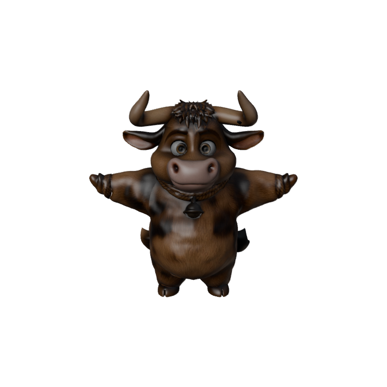
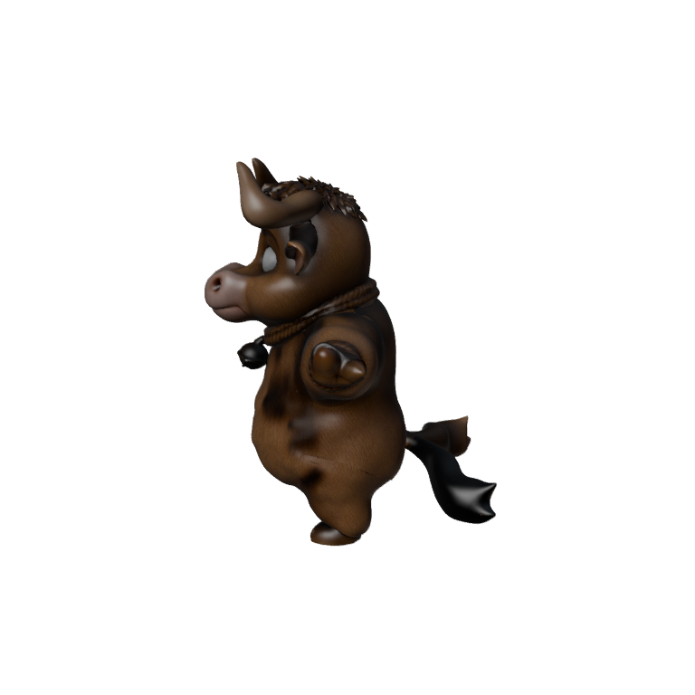
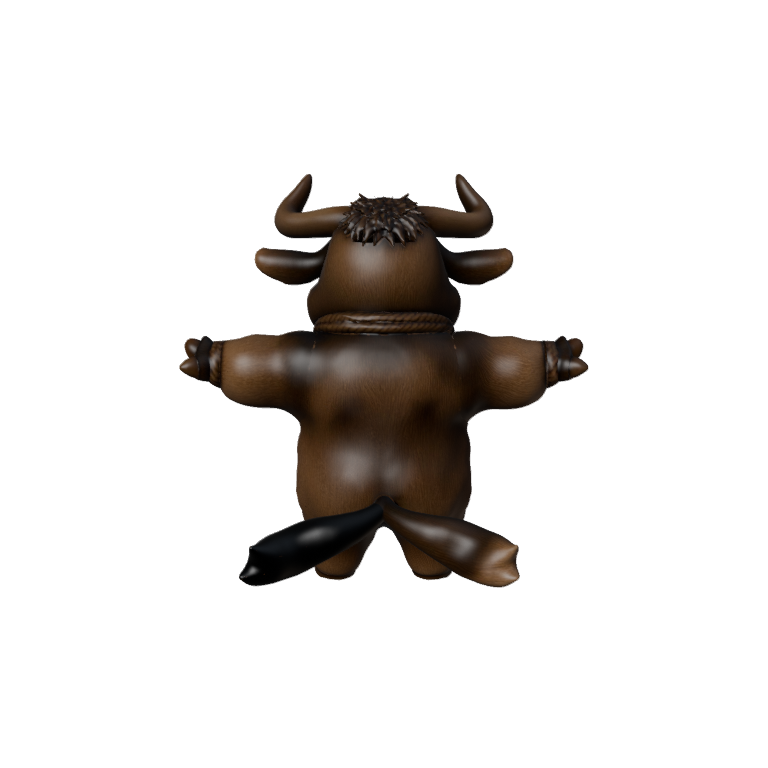
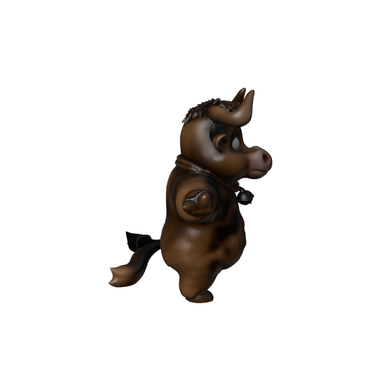
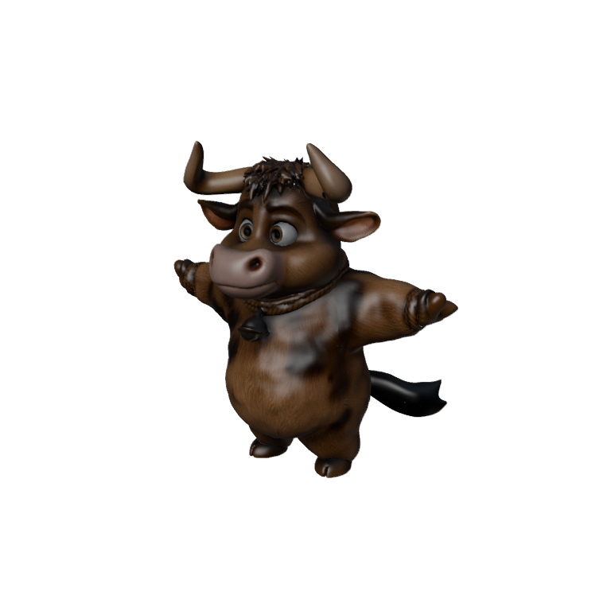
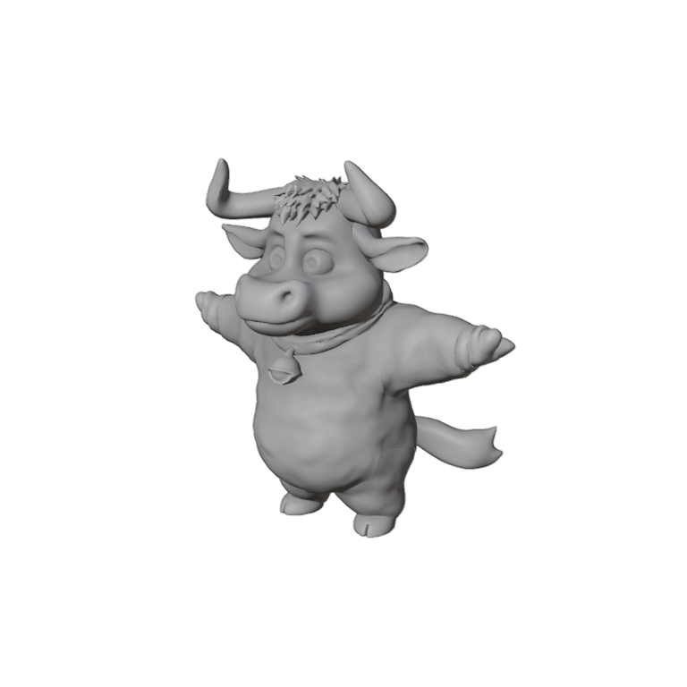

Warnings (not blocking):
- TEXEL_DENSITY_OFF_TARGET (Body): texel density 2504 px/m vs target 1024

<details><summary>metrics</summary>

```json
{
  "parts": {
    "Body": {
      "mesh": {
        "tris": 83314,
        "verts": 42942,
        "non_manifold_edges": 0,
        "boundary_edges": 2552,
        "ngons": 2,
        "quad_ratio": 0.996,
        "shells": 22,
        "dimensions_m": [
          0.9796,
          0.753,
          0.9907
        ]
      },
      "uv": {
        "has_uv": true,
        "utilization": 0.7325,
        "overlap_pct": 0.029,
        "texel_density_px_per_m": 2504.5,
        "texel_density_cv": 0.1255,
        "out_of_bounds_ratio": 0.0,
        "zero_area_uv_tris": 0
      },
      "weights": {
        "weighted": true,
        "vertex_groups": 67,
        "verts_over_influence_limit": 1217,
        "unweighted_verts_pct": 0.0,
        "not_normalized_pct": 73.634
      }
    }
  }
}
```
</details>

## unity (mobile)
Budget 15000 tris, textures 2048px, 4 bone influences

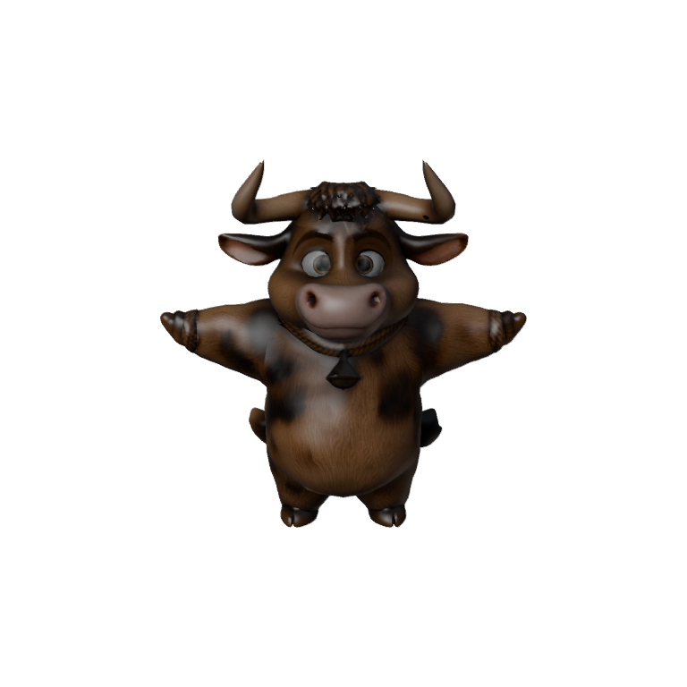
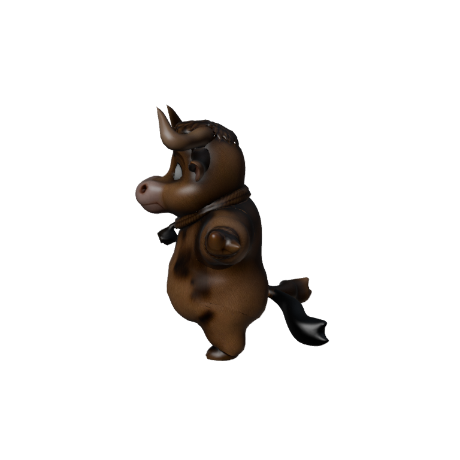
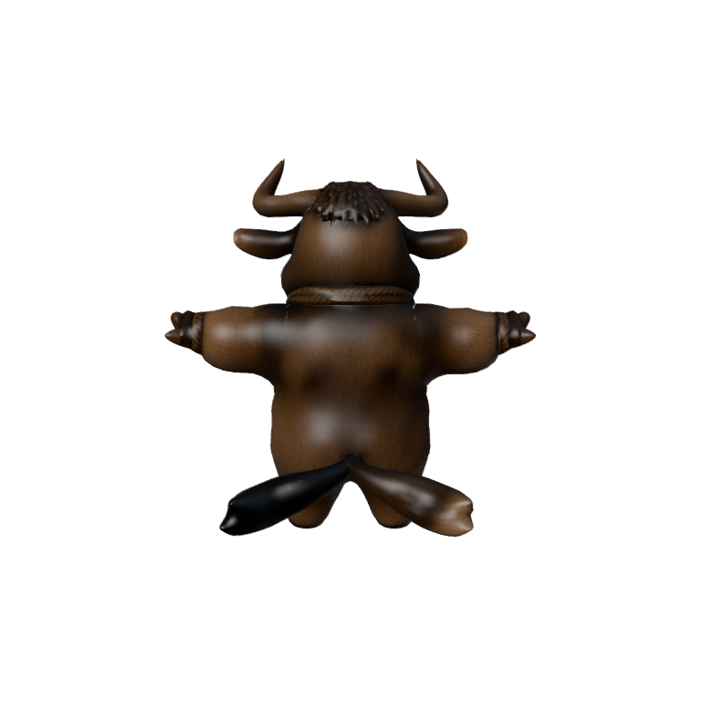
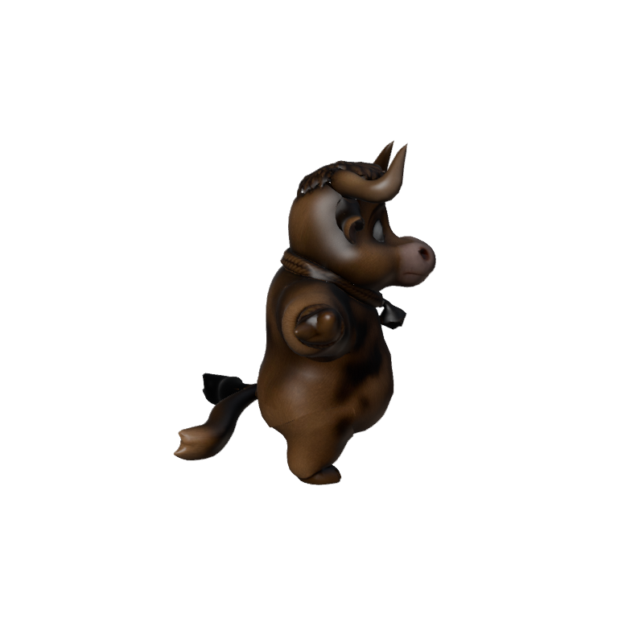
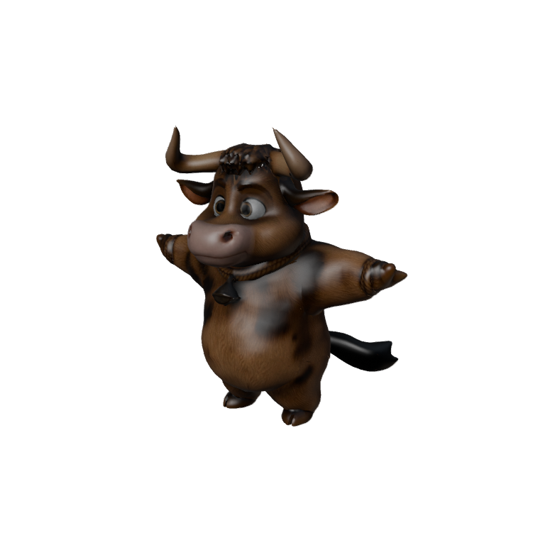
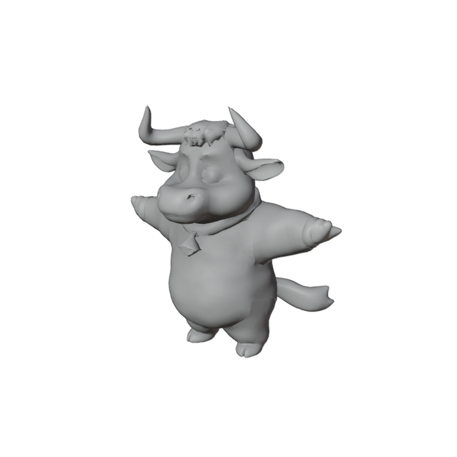

Warnings (not blocking):
- RETOPO_FALLBACK (Body): quad remesh failed, decimation was used (triangles, worse deformation)
- TEXEL_DENSITY_OFF_TARGET (Body): texel density 1266 px/m vs target 512
- SKELETON_TOO_HEAVY (None): 345 bones > 75 recommended for mobile

<details><summary>metrics</summary>

```json
{
  "parts": {
    "Body": {
      "mesh": {
        "tris": 14999,
        "verts": 8078,
        "non_manifold_edges": 2,
        "boundary_edges": 1145,
        "ngons": 0,
        "quad_ratio": 0.0,
        "shells": 20,
        "dimensions_m": [
          0.9747,
          0.7538,
          0.9941
        ]
      },
      "uv": {
        "has_uv": true,
        "utilization": 0.706,
        "overlap_pct": 0.018,
        "texel_density_px_per_m": 1266.04,
        "texel_density_cv": 0.0956,
        "out_of_bounds_ratio": 0.0,
        "zero_area_uv_tris": 5
      },
      "weights": {
        "weighted": true,
        "vertex_groups": 64,
        "verts_over_influence_limit": 0,
        "unweighted_verts_pct": 0.0,
        "not_normalized_pct": 0.0
      }
    }
  }
}
```
</details>
